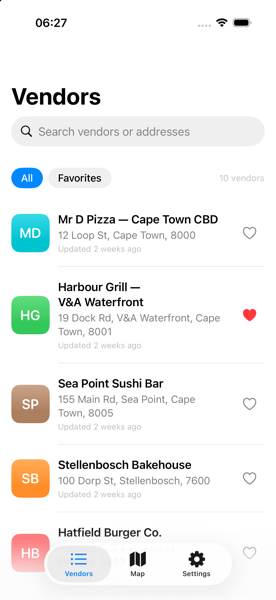
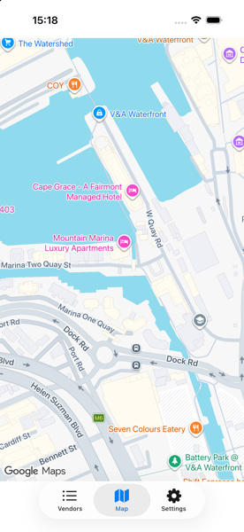
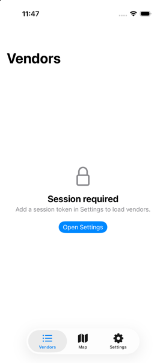
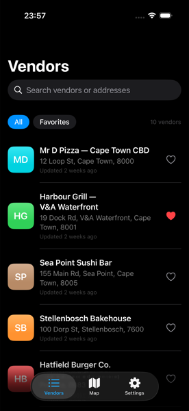
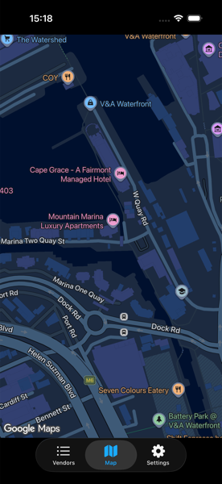

# Mr D Vendor Locator

[](https://github.com/Terence8701/mrd-vendor-locator/actions/workflows/ci.yml)

A SwiftUI iOS app for browsing Mr D vendors, seeing them on a Google Map, and managing a session token stored in the iOS Keychain.

Built for the Mr D Senior iOS Engineer assignment. Design decisions and trade-offs are in [SOLUTION.md](SOLUTION.md); how AI was used is in [AI_USAGE.md](AI_USAGE.md).

| Vendors | Map | Session required |
|---|---|---|
|  |  |  |
|  |  | |

## Features

- **Vendor list** with search, an All / Favorites filter, favorites, pull to refresh, and loading, empty and error states with friendly messages.
- **Google Map** with a marker per vendor. Tapping a vendor in the list switches to the map and recenters on it; tapping a marker shows a vendor card, which leads back to that vendor in the list.
- **Places address → coordinates:** vendors that only have an address are geocoded with the Google Places SDK and appear on the map.
- **Session token in the Keychain**, managed from Settings (masked by default, reveal, save, clear). Every API request sends it as a Bearer token.
- **Light and dark mode**, switching live.

The API is a local stub (`StubURLProtocol`), so no backend is needed. It requires a token (any value works) and returns 401 without one.

## Requirements

- **Xcode 27** (the project was created with it; the Google Maps and Places SDKs need Xcode 26 or later).
- **iOS 17.0+** deployment target. The brief asks for iOS 16, which Xcode 27 can no longer target — see [SOLUTION.md](SOLUTION.md#deviations-from-the-brief).
- Dependencies come from Swift Package Manager and resolve on first open: Google Maps SDK and Google Places SDK for iOS (11.2.0).

## Setup

1. Clone the repo and open the project:
   ```
   git clone https://github.com/Terence8701/mrd-vendor-locator.git
   open mrd-vendor-locator/MrDVendorLocator/MrDVendorLocator.xcodeproj
   ```
2. **Add a Google Maps Platform API key** (optional, but needed for the map):
   - In Google Cloud, enable **Maps SDK for iOS** and **Places API (New)**, and restrict the key to the bundle ID `com.baloyi.mrdvendorlocator`.
   - Create `Config/Secrets.xcconfig` (it is gitignored) containing:
     ```
     GMS_API_KEY = your_key_here
     ```
   - Without a key the app still builds and runs: the Map tab explains that no key is set, and geocoding falls back to a built-in table (`MockGeocoder`).
3. Choose an iOS 17+ simulator and run (**Cmd+R**).
4. The first launch shows **Session required**. Open **Settings**, enter any token (for example `mrD_token_example_123`) and tap **Save**. The vendors load.

### Demoing error states

In Debug builds, **Settings → Developer → Stub API response** switches the stub to a **500** or **offline** response. Pull to refresh on the Vendors tab to see the error, then set it back to **Success**.

## Tests

40 XCTest unit tests. They never call Google or the network.

- In Xcode: **Cmd+U**.
- From the command line:
  ```
  xcodebuild test \
    -project MrDVendorLocator/MrDVendorLocator.xcodeproj \
    -scheme MrDVendorLocator \
    -destination 'platform=iOS Simulator,name=iPhone 17 Pro' \
    -parallel-testing-enabled NO
  ```
- With Fastlane (`brew install fastlane`, or `bundle install` and prefix with `bundle exec`):
  ```
  fastlane test                                  # unit tests on the default simulator
  fastlane test device:"iPhone 17 Pro (26.5)"    # or a specific one
  fastlane build                                 # unsigned simulator build
  ```

**CI:** GitHub Actions ([`.github/workflows/ci.yml`](.github/workflows/ci.yml)) runs the tests on every push and pull request.

## Project structure

```
Config/                     App.xcconfig (committed), Secrets.xcconfig (gitignored), Info.plist
MrDVendorLocator/
  MrDVendorLocator/
    App/                    Entry point, composition root (AppDependencies), tab view
    Core/
      Networking/           APIClient, Endpoint, APIError
      Stub/                 StubURLProtocol + vendors.json (the local API)
      Security/             TokenStore, KeychainTokenStore
      Places/               Geocoding, GooglePlacesGeocoder, CachingGeocoder, MockGeocoder
    Data/                   Vendor model, VendorRepository, FavoritesStore
    Features/               VendorList, Map, Settings (views + view models)
    Shared/                 ViewState, UserFacingError, DesignSystem (vendor tile)
  MrDVendorLocatorTests/    Unit tests
```
